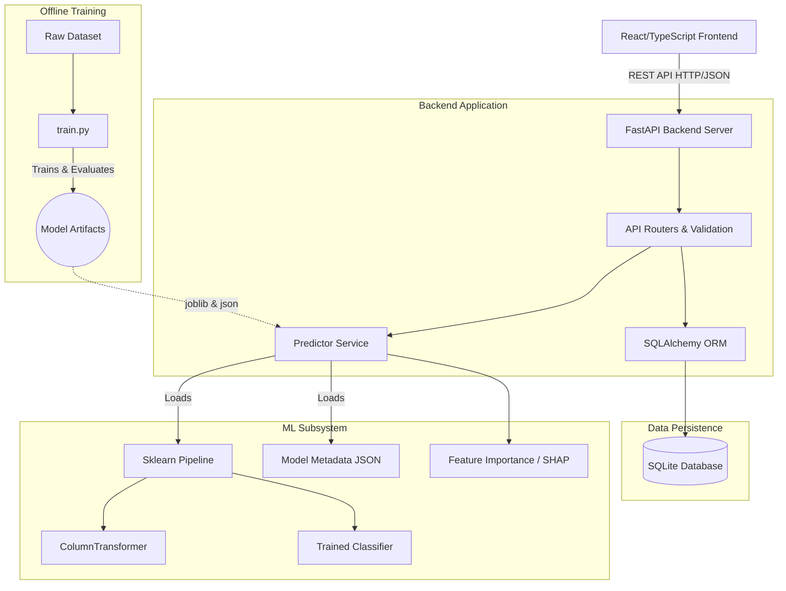

# System Architecture

The Credit Intelligence platform is designed as a decoupled, three-tier web application emphasizing separation of concerns, scalability, and ease of deployment.

## High-Level Architecture Diagram

## Component Details

### 1. Frontend Layer
- **Tech Stack**: React 18, TypeScript, Vite.
- **Routing**: React Router v6 handles client-side navigation.
- **State Management**: React Hooks (`useState`, `useEffect`) combined with an Axios service layer for API communication.
- **Styling**: Vanilla CSS with custom properties (CSS Variables) implementing a cohesive design system without heavy framework lock-in.
- **Visualization**: Recharts for dynamic, responsive SVG charting.

### 2. Backend Layer
- **Tech Stack**: FastAPI (Python), Uvicorn.
- **API Design**: RESTful principles. Pydantic models enforce strict request/response validation schemas (`app/schemas/`).
- **Lifecycle**: The ML model artifacts (`.joblib` and `.json`) are loaded into memory exactly once during application startup (`@asynccontextmanager lifespan`) to ensure low-latency predictions.

### 3. ML Inference Layer
- **Pipeline**: Scikit-learn `Pipeline` encapsulating both the `ColumnTransformer` (imputation, scaling, one-hot encoding) and the estimator. This ensures zero training-serving skew.
- **Explainability**: Handled by the `ModelService`. It extracts global feature importance or computes local SHAP/permutation importance values for individual predictions.

### 4. Database Layer
- **Tech Stack**: SQLite (via SQLAlchemy).
- **Schema**: A single `predictions` table stores applicant input features, generated risk scores, probabilities, and the top explanatory factors.
- **Extensibility**: The SQLAlchemy abstraction allows seamless migration to PostgreSQL or MySQL for production deployments.
